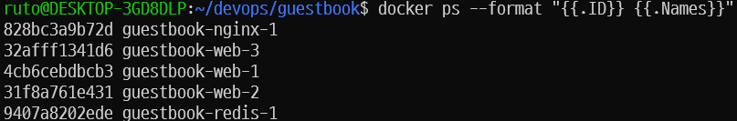

# 7주차: compose + nginx + healthcheck
## `docker compose ps` 결과
```
NAME                IMAGE            COMMAND                  SERVICE   CREATED         STATUS                   PORTS
guestbook-nginx-1   nginx:alpine     "/docker-entrypoint.…"   nginx     3 minutes ago   Up 3 minutes             0.0.0.0:8080->80/tcp, [::]:8080->80/tcp
guestbook-redis-1   redis:7-alpine   "docker-entrypoint.s…"   redis     3 minutes ago   Up 3 minutes (healthy)   6379/tcp
guestbook-web-1     guestbook-web    "python app.py"          web       3 minutes ago   Up 3 minutes (healthy)   5000/tcp
guestbook-web-2     guestbook-web    "python app.py"          web       2 minutes ago   Up 2 minutes (healthy)   5000/tcp
guestbook-web-3     guestbook-web    "python app.py"          web       2 minutes ago   Up 2 minutes (healthy)   5000/tcp
```
## scale 후 각 웹 컨테이너 호스트명 (컨테이너 ID)이 바뀐 결과 (캡처)

## `down` 후 `up`과 `down -v` 후 `up` 차이 비교
`-v` 옵션 없이 `docker compose down`하면 compose.yaml에 지정했던 volumes의 데이터가 사라지지 않고 컨테이너와 네트워크만 지워진다.
반대로 `docker compose down -v`하면 볼륨을 포함해 down한다.
## .env를 Git에 올리지 않는 이유
실습 3에서 compose.yaml에 redis 비밀번호를 노출하지 않기 위해\
.env 파일에 비밀번호를 넣고 compose.yaml에서 그 값을 가져오는 방식으로 바꾸었다.

이 비밀번호가 포함된 .env 파일을 Git에 올리고, 그 커밋을 GitHub에 올리면 비밀번호가 노출되게 된다.\
이를 방지하기 위해 저장소 루트 디렉토리에 .gitignore를 사용해 Git에서 .env 파일을 올리지 않게 하는 것이다.
